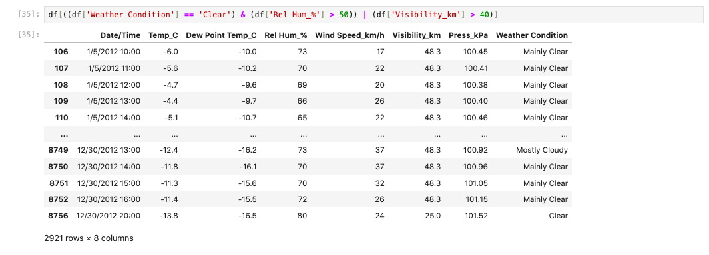
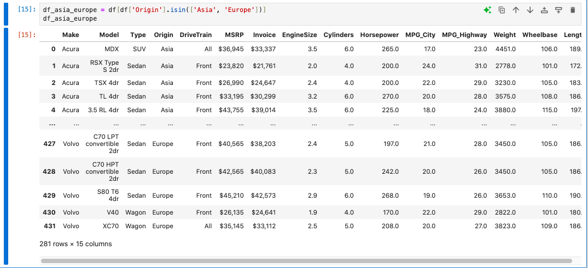

# Data Science Project (EDA 01-05)

**Author:** CHEN LIN (GitHub: [clin689](https://github.com/clin689))

## 1. Problem / Research Question
This project explores five real-world datasets using Exploratory Data Analysis (EDA):
1. **Weather Data:** How do weather conditions relate to visibility and pressure?
2. **Cars Data:** How do specifications vary across brands and origins?
3. **Police Data:** Are there gender differences in search rates during traffic stops?
4. **Covid-19 Data:** Which regions had the most confirmed cases?
5. **London Housing Data:** How have prices and crime rates changed over time?

## 2. Dataset Source and Usage Permissions
All datasets are course-provided CSV files for CISC7204 and are used for academic purposes only. No personal, sensitive, or restricted data is included.

## 3. Methods and Tools
- **Python 3.12** with **pandas**, **numpy**, **seaborn**, **matplotlib**.
- Techniques used: Data cleaning, missing-value imputation, groupby aggregation, boolean filtering, and visualization.

## 4. Key Findings and One Limitation
- **Weather:** Average visibility is ~27.66 km. 583 records contain "Snow".
- **Cars:** Toyota (28) and Chevrolet (27) are the most frequent brands.
- **Police:** Males have a higher search rate (4.68%) compared to females (2.24%).
- **Covid-19:** The US had the highest confirmed cases (1,039,909).
- **Housing:** England's average price rose from ~52,788 (1995) to 247,355 (2020).

**Limitation:** The analysis is purely descriptive; no inferential statistics or predictive modeling was performed.

## 5. Instructions to Run the Analysis
```bash
git clone https://github.com/clin689/data-science-project.git
cd data-science-project
pip install -r requirements.txt
jupyter notebook

## Visualizations


